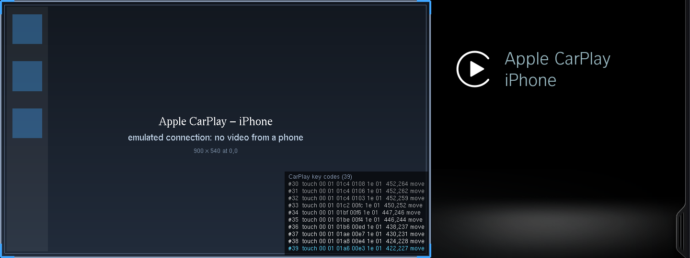

# CarPlay in IDEmu (iDrive 5/6, NBT Evo)

The HMI shows its real CarPlay screens in IDEmu without a phone and without the Connectivity process: the CarPlay state reaches the
HMI over MOST, and IDEmu's virtual MOST bridge plays those messages ("fake iPhone"). Everything is driven from the **CarPlay** tab of
the run screen (shown while an iDrive 5/6 environment is booting or running).

## Using it

1. Start an iDrive 5/6 environment and open the **CarPlay** tab.
2. If the environment lacks CarPlay, the tab says what is missing and offers **Set up CarPlay**. It does what a coded car has:
   `"conn": true` and the variants `0x5153` (CarPlay entry in the main menu) and `0x4E59` (Bluetooth) in `env.json`, and
   `CARPLAY_SWT = 1` through the coding flash (the current coding is backed up, the shim is rebuilt and the head unit restarts).
3. Switch on **Connect fake iPhone**. The HMI gets a paired iPhone with CarPlay, adds CarPlay to the main menu and switches to the
   CarPlay screen. The video area shows a placeholder (frame, title, size and position of the video layer).
4. **Show keystrokes** lists, in a corner of the CarPlay video, the codes the HMI sends to CarPlay for each controller key and
   each touch on the screen (raw bytes + decoded).
   

A real iPhone cannot connect: it checks the accessory's Apple MFi authentication chip, which the emulated hardware does not have.

## How it works

* **Activation.** In the car the SWT (software activation) service enables CarPlay. IDEmu has no SWT server, so with `"conn": true`
  the builder puts `/fs/shim/carplay.on` in the shim and `src/shim/hook.c` (`hk_swt`) sets `CPEnabled` right after
  `CHMISWTService`'s init. The builder finds that function (`SWT_INIT`) and the `CPEnabled` offset (`SWT_CP`) in the HMI binary at build
  time (`idemu/hmiscan.py`, `idemu/data/hmi_hooks.json`); if they are not found, CarPlay does not activate (see the build log).
* **Fake iPhone** (`idemu/carplay.py`), in order:
  * Bluetooth 0x54/0 `BTDFunctionalityViewer` (0xC10): device list; record = name | BT address | 3 bytes | trusted | u32 apps |
    index. apps = 4 bits per application (bit 2 = connected): Phone1 0-3, Audio 4-7, Phone2 16-19, **Carplay 28-31**.
  * AuxIn 0x24/0x70 `DeviceInfo2` (0xCC8): record 0, second byte 2 = CarPlay device connected (main menu gets its CarPlay entry).
  * AuxIn `CarPlayModesChanged` (0xCD2, 27 bytes): resource 1 = main screen, owner 1 = phone, 2 = car. Phone owns the screen ->
    `CCarPlayActivity`.
  * AuxIn `VideoReady` (0x136): `00 00 01 ...` (8 bytes) -> projected mode (video area, side panel).
  * From the HMI: `CarPlayControllerInput` (0xCD3, 8 bytes: rotation 1..126 clockwise / 128.. counter-clockwise, press, back, up,
    down, left, right, voice), `CarPlayTouchInput` (0xCD5, a touch on the screen: u8 type (0 = screen), u8 count, then per finger
    u16 x, u16 y in display pixels, u8 z, u8 state 0 down / 1 move / 2 up) and `CarPlayChangeModes` (0xCD1). `idemu/most.py` lists
    the controller input and the touches on the video when "Show keystrokes" is on.
* **Video placeholder.** The CarPlay video layer is `0x800d0000` (surface `0x500`, Connectivity's screen window). The shim's ILM
  (`src/shim/ilm.c`) reports its destination rectangle to the host (op `OP_VIDLAYER`), and glhost draws the placeholder there, under
  the HMI like the map (`src/glhost/map.c`). Input commands on `<ctl>/input.sock`: `V t title|subtitle`, `V k <text>` (`V k` alone
  clears the key list).
* **Display.** IDEmu's default for `UserMonitorControl` (SystemFunctionPowerMode 0xD1/2, 0x432) is 1: with 0 the HMI switched the
  display off whenever it re-read that property, a few seconds into CarPlay.

## API

* `GET /api/carplay` -> `{state: off|connecting|connected|disconnecting|error, step, error, name, show_keys, missing: [...], flash}`
* `POST /api/carplay` with `{fake_iphone: true|false}`, `{show_keys: true|false}` or `{setup: true}`.
